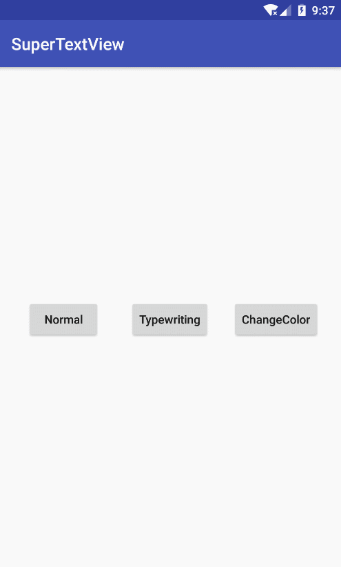

# SuperTextView

[](https://jitpack.io/#jenly1314/SuperTextView)
[](https://raw.githubusercontent.com/jenly1314/SuperTextView/master/app/app-release.apk)
[](https://developer.android.com/guide/topics/manifest/uses-sdk-element#ApiLevels)
[](https://opensource.org/licenses/mit)

SuperTextView for Android 是一个在TextView的基础上扩展了几种动画效果的控件。

## 效果展示


> 你也可以直接下载 [演示App](https://raw.githubusercontent.com/jenly1314/SuperTextView/master/app/app-release.apk) 体验效果

## 引入

### Gradle:

1. 在Project的 **build.gradle** 或 **setting.gradle** 中添加远程仓库

    ```gradle
    repositories {
        //...
        mavenCentral()
        maven { url 'https://jitpack.io' }
    }
    ```

2. 在Module的 **build.gradle** 中添加依赖项

    ```gradle
    implementation 'com.github.jenly1314:SuperTextView:1.0.1'
    ```

## 使用

布局示例
```Xml
<com.king.view.supertextview.SuperTextView
    android:id="@+id/superTextView"
    android:layout_width="wrap_content"
    android:layout_height="wrap_content" />
```

代码示例（核心调用代码）
```Java
//设置动画的动态监听（动画结束后回调）
superTextView.setOnDynamicListener(OnDynamicListener onDynamicListener);
//设置动画的动态风格
supertextview.setDynamicStyle(DynamicStyle dynamicStyle);
//设置动画的动态文本
supertextview.setDynamicText(CharSequence text);
//开始动画
supertextview.start();

```

更多使用详情，请查看[app](app)中的源码使用示例或直接查看[API帮助文档](https://jitpack.io/com/github/jenly1314/SuperTextView/latest/javadoc/)

## 相关推荐
- [SpinCounterView](https://github.com/jenly1314/SpinCounterView) 一个类似码表变化的旋转计数器动画控件。
- [CounterView](https://github.com/jenly1314/CounterView) 一个数字变化效果的计数器视图控件。
- [RadarView](https://github.com/jenly1314/RadarView) 一个雷达扫描动画后，然后展示得分效果的控件。
- [LoadingView](https://github.com/jenly1314/LoadingView) 一个圆弧加载过渡动画，圆弧个数，大小，弧度，渐变颜色，完全可配。
- [WaveView](https://github.com/jenly1314/WaveView) 一个水波纹动画控件视图，支持波纹数，波纹振幅，波纹颜色，波纹速度，波纹方向等属性完全可配。
- [GiftSurfaceView](https://github.com/jenly1314/GiftSurfaceView) 一个适用于直播间送礼物拼图案的动画控件。
- [FlutteringLayout](https://github.com/jenly1314/FlutteringLayout) 一个适用于直播间点赞桃心飘动效果的控件。
- [DragPolygonView](https://github.com/jenly1314/DragPolygonView) 一个支持可拖动多边形，支持通过拖拽多边形的角改变其形状的任意多边形控件。
- [CircleProgressView](https://github.com/jenly1314/CircleProgressView) 一个圆形的进度动画控件，动画效果纵享丝滑。
- [ArcSeekBar](https://github.com/jenly1314/ArcSeekBar) 一个弧形的拖动条进度控件，配置参数完全可定制化。
- [DrawBoard](https://github.com/jenly1314/DrawBoard) 一个自定义View实现的画板；方便对图片进行编辑和各种涂鸦相关操作。
- [compose-component](https://github.com/jenly1314/compose-component) 一个Jetpack Compose的组件库；主要提供了一些小组件，便于快速使用。

---


